<div align="center">

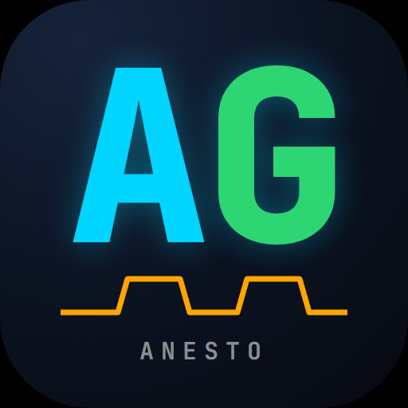

# AnestoGuia

**Guia clínico, material de estudo e banco de questões de anestesiologia — no bolso, grátis e sem internet.**

[](https://vinihammoud-create.github.io/anestoguia/)


<br>

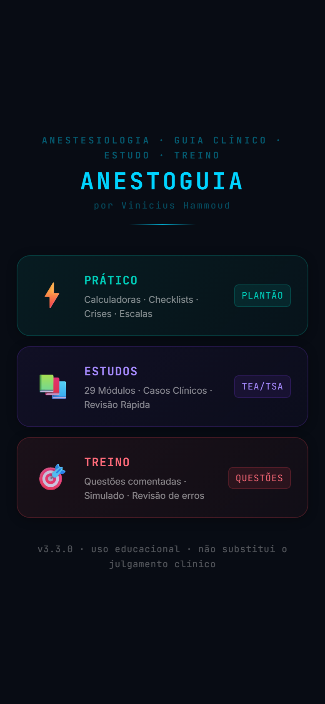
&nbsp;
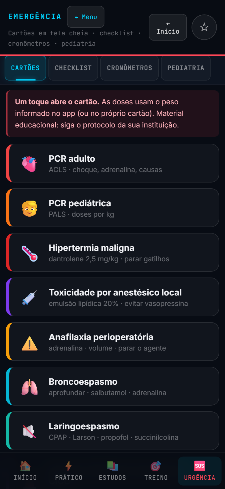
&nbsp;
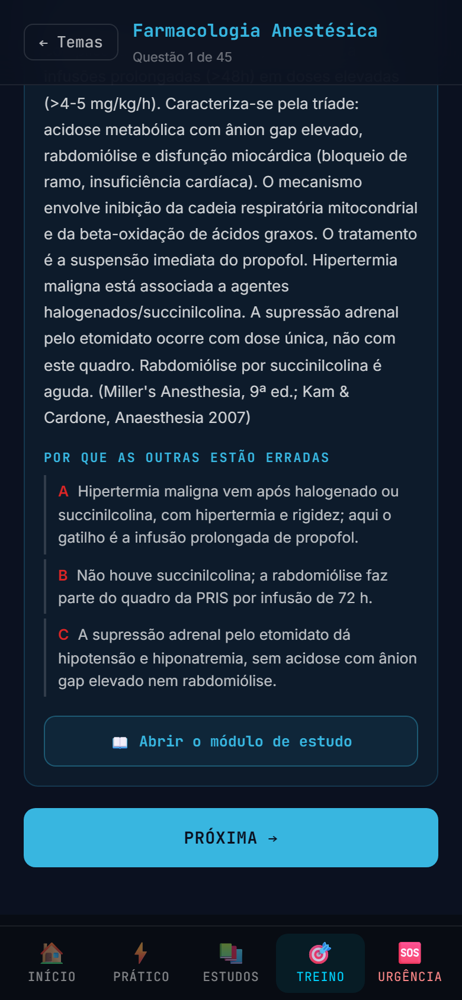

</div>

---

## O que é

O **AnestoGuia** é um aplicativo para anestesiologistas, residentes e estudantes, feito por um anestesiologista para ser usado no plantão e na preparação para as provas **TEA/TSA**. Ele reúne, em um só lugar:

- o que se precisa **na hora**: doses por peso, cartões de emergência, calculadoras, checklists;
- o que se precisa **para estudar**: 29 módulos aprofundados, com pérolas de prova e referências;
- o que se precisa **para treinar**: mais de mil questões comentadas, simulado cronometrado e revisão dos erros.

Não precisa de login, não tem anúncio e não envia dados seus para lugar nenhum. Abre no celular como um app de verdade e **funciona sem internet**, inclusive no centro cirúrgico, no subsolo ou em hospital sem sinal.

> **Aviso importante:** material educacional. Não substitui o julgamento clínico, as bulas, as diretrizes vigentes nem os protocolos da sua instituição. Confira sempre doses e condutas antes de aplicá-las em um paciente.

## Abrir e instalar

**Link:** https://vinihammoud-create.github.io/anestoguia/

Abra o link no navegador do celular uma vez, com internet. Em seguida, instale:

| Aparelho | Como instalar |
|---|---|
| **Android (Chrome)** | Menu ⋮ → **Instalar app** (ou **Adicionar à tela inicial**) |
| **iPhone / iPad (Safari)** | Botão **Compartilhar** → **Adicionar à Tela de Início** |
| **Computador (Chrome ou Edge)** | Ícone de instalação na barra de endereço → **Instalar** |

O ícone do AnestoGuia aparece na tela inicial e o app abre em tela cheia, como qualquer outro aplicativo.

### Como usar offline

1. Abra o app **uma vez com internet**. Nesse primeiro acesso ele baixa tudo de uma vez: os 29 módulos, as mais de mil questões e todas as figuras (cerca de 5 MB).
2. Pronto. Dali em diante, até no modo avião, **todas as telas funcionam**: calculadoras, cartões de emergência, módulos, Treino e simulado.
3. Quando houver internet, o app confere se existe versão nova e se atualiza sozinho. Ao reabrir, aparece o aviso de nova versão.

O funcionamento offline é coberto por um teste automático (`tools/test-offline.js`): ele corta a rede e confere se módulos, figuras, Treino e emergência abrem.

## Para que serve cada parte

<table>
<tr>
<td width="33%" align="center">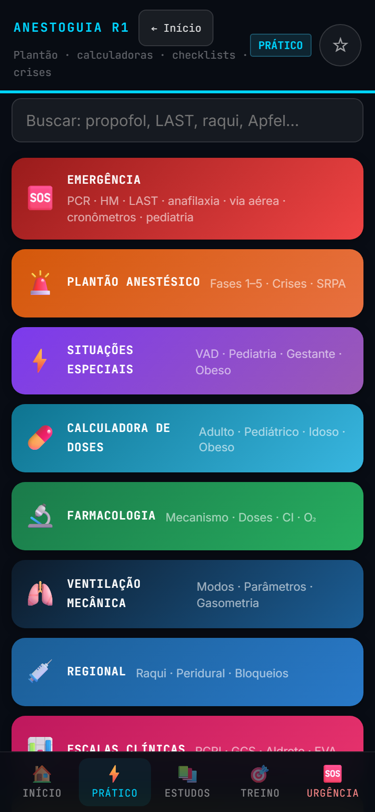</td>
<td width="33%" align="center">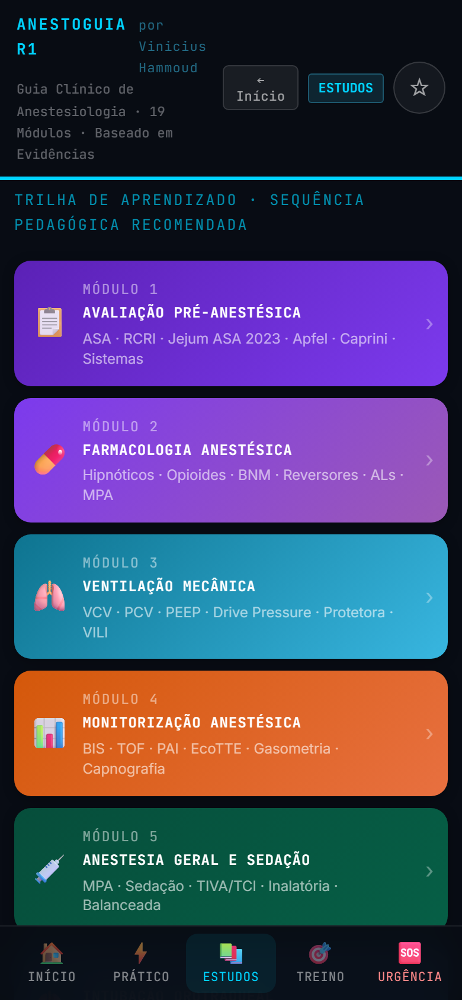</td>
<td width="33%" align="center">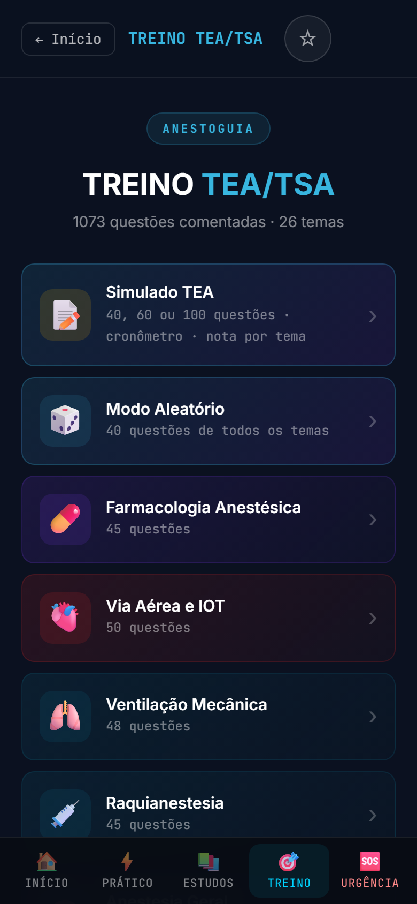</td>
</tr>
<tr>
<td align="center"><b>Prático</b><br>para o plantão</td>
<td align="center"><b>Estudos</b><br>para aprofundar</td>
<td align="center"><b>Treino</b><br>para a prova</td>
</tr>
</table>

### ⚡ Prático — para usar no plantão

- **Plantão anestésico** organizado pelas fases da anestesia.
- **Situações especiais** do dia a dia.
- **Calculadoras**: doses por peso, TCI, bomba de infusão, fluidos, MABL, sódio, potássio, gasometria e outras.
- **Farmacologia**, **ventilação mecânica** e **regional** em formato de consulta rápida.
- **Escalas clínicas** (Apfel, RCRI, ASA, Mallampati, Aldrete e outras), **ERAS** e analgesia multimodal.
- **Favoritos ★**: fixe qualquer tela, aba ou cartão no início.

### 🆘 Emergência — em tela cheia, com a dose já calculada

Informe o peso uma vez e os cartões calculam as doses para o paciente:

<table>
<tr>
<td width="50%" align="center">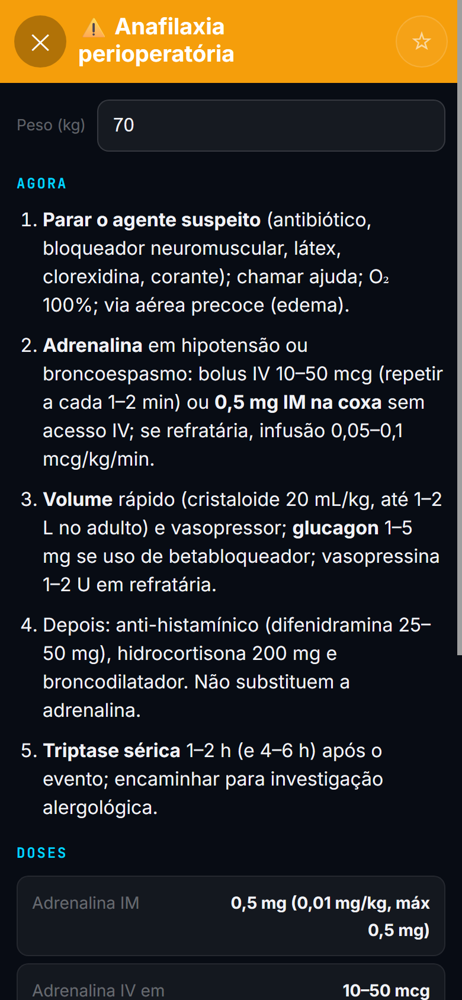</td>
<td width="50%" align="center">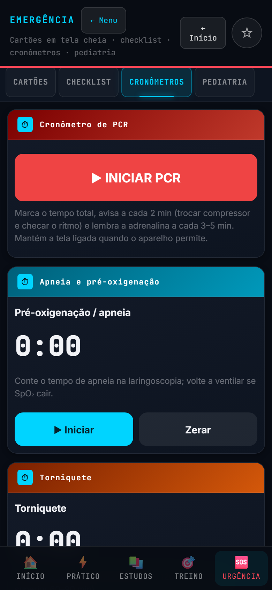</td>
</tr>
</table>

**10 cartões:** PCR adulto · PCR pediátrica · Hipertermia maligna · Toxicidade por anestésico local (LAST) · Anafilaxia perioperatória · Broncoespasmo · Laringoespasmo · Via aérea difícil não antecipada / CICO · Hipotensão refratária · Bradicardia.

Também há **checklist de cirurgia segura**, **cronômetros** (PCR com aviso a cada 2 minutos, apneia/pré-oxigenação e torniquete) e um painel de **pediatria**.

### 📚 Estudos — 29 módulos em profundidade

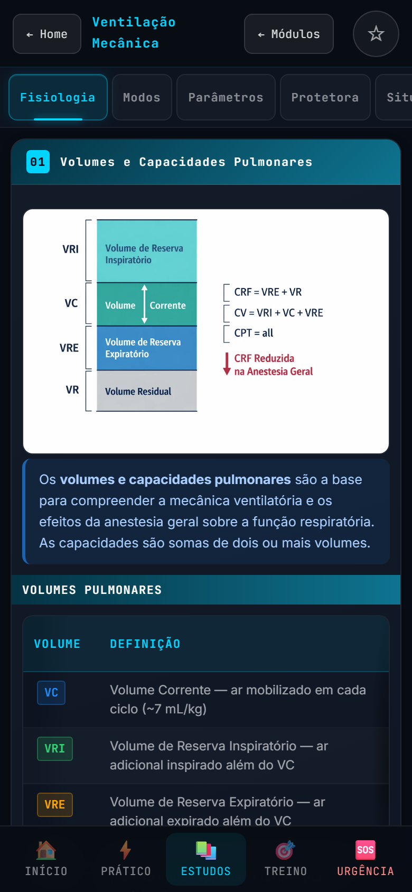

Cada módulo tem abas, tabelas, figuras, casos clínicos, **pérolas de prova**, a seção **"Como é no Brasil"** e referências.

- Avaliação pré-anestésica · Farmacologia anestésica · Ventilação mecânica · Monitorização
- Anestesia geral e sedação · Intubação orotraqueal · Via aérea difícil · Raquianestesia
- Analgesia multimodal · Reposição volêmica e hemoterapia · Acesso vascular central
- Anestesia pediátrica · SRPA · Gestão de crises · Ultrassonografia (POCUS) · Cálculos clínicos
- Obstetrícia · Fisiologia aplicada · Cirurgias especiais · Aparelho e física
- Ética, CFM e segurança · Estatística e MBE · Dor crônica e intervencionista
- Fora do centro cirúrgico e ambulatorial · Transplantes e doador · Trauma e queimados
- Anestesia cardíaca e CEC · Torácica e ventilação monopulmonar · Neuroanestesia

<br clear="right">

### 🎯 Treino — mais de mil questões comentadas

- **1.073 questões** em 26 temas, no estilo das provas TEA/TSA, com gabarito e justificativa.
- **"Por que as outras estão erradas":** depois de responder, cada alternativa errada é explicada, e não só a certa.
- **Simulado cronometrado** de 40, 60 ou 100 questões, com revisão no final.
- **Revisão de erros com repetição espaçada:** as questões que você errou voltam no momento certo.
- **Estatísticas** por tema e **exportação/importação do progresso** (para trocar de aparelho ou guardar um backup).
- Cada questão tem um atalho para o módulo de estudo correspondente.

<p align="center">
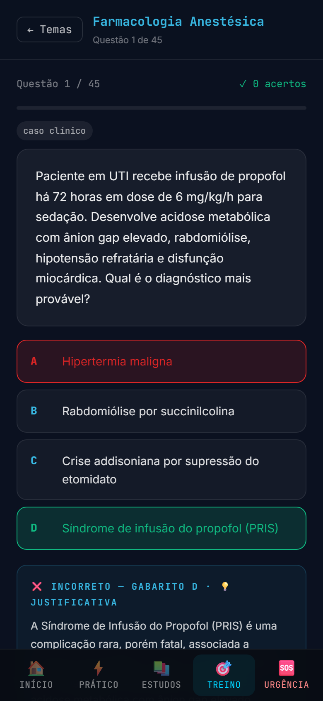
&nbsp;&nbsp;
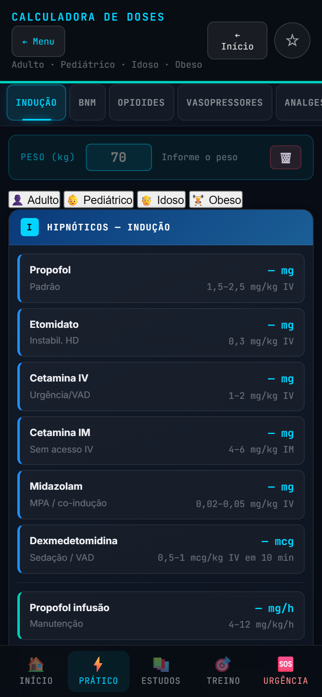
</p>

## Vantagens

- **Funciona sem internet.** Depois do primeiro acesso, tudo fica no aparelho.
- **Grátis, sem cadastro, sem anúncio.** Você não cria conta nem informa e-mail.
- **Privacidade.** Não há rastreadores nem envio de dados. Peso, favoritos e estatísticas ficam só no seu aparelho. O app não carrega nada de servidores externos; apenas os links de referências (DOI) abrem fora do app quando você toca neles.
- **Leve.** A tela inicial carrega cerca de 200 KB; o resto vem sob demanda e fica guardado.
- **Feito para uma mão só.** Tela vertical, botões grandes, tema escuro que não ofusca no centro cirúrgico.
- **Três usos, um só lugar.** Consultar no plantão, estudar e treinar sem trocar de aplicativo.
- **Conteúdo em português**, com o contexto brasileiro (CFM, normas e a prática daqui).
- **Aberto.** O código é público: qualquer pessoa pode ler, conferir e sugerir correções.
- **Sempre atualizado.** Quando o conteúdo muda, o app se atualiza sozinho assim que houver internet.

## Perguntas frequentes

**Preciso baixar na Play Store ou na App Store?** Não. Ele é um *web app instalável* (PWA): abre pelo link e se instala pelo próprio navegador, sem loja.

**Troquei de celular e o progresso do Treino sumiu.** O progresso fica no aparelho. Em **Treino**, use **Exportar** no aparelho antigo e **Importar** no novo.

**Funciona no iPhone?** Sim, pelo Safari. Use *Adicionar à Tela de Início*.

**Como atualizo?** Não precisa. Com internet, o app baixa a versão nova sozinho. Para forçar, feche e reabra o app.

**Encontrei um erro de conteúdo ou de dose.** Obrigado por avisar! Abra uma [issue](../../issues) descrevendo a tela e o que está errado, de preferência com a fonte.

## Como contribuir

Correções de conteúdo, sugestões de módulos e novas questões são bem-vindas: abra uma [issue](../../issues) ou um pull request. Antes de enviar mudanças no código, rode `node tools/test-all.js`.

## Para quem quer ver por dentro

O app é um site estático, sem etapa de build e sem dependências. Os módulos são carregados sob demanda e o service worker guarda tudo para uso offline.

```
index.html          casca do app: launcher, modo Prático, menu de Estudos, Treino
css/app.css         estilos
js/store.js         AG_STORE (localStorage)
js/calc.js          calculadoras clínicas (TCI, fluidos, MABL, Na, K, gasometria)
js/app.js           funções do app (abas, accordions, calculadoras do Prático, busca, timers)
js/router.js        navegação por hash, histórico, carregamento dos módulos
js/treino.js        treino: temas, simulado, revisão espaçada, exportar/importar progresso
js/plantao.js       tela Emergência (cartões, checklist, cronômetros, pediatria) e favoritos
data/questoes.json  banco de questões (temas → questões A–D com gabarito e justificativa)
modulos/<id>.html   um arquivo por módulo de Estudos, carregado sob demanda
sw.js               service worker (instala tudo para uso offline)
tools/              verificação estática, testes no navegador, versão do cache
docs/screenshots/   capturas de tela usadas neste README
```

Rodar localmente (os módulos usam `fetch`, então abrir o arquivo com `file://` não funciona):

```
node tools/serve.js        # ou: npx serve .   /   python -m http.server 8080
node tools/check.js        # verificação estática
node tools/test-all.js     # todos os testes (precisa do Edge ou Chrome para os de navegador)
node tools/bump-sw.js      # antes de publicar: atualiza a versão do cache
```

Formato de uma questão:

```json
{
  "id": "farma_01",
  "tema": "Farmacologia Anestésica",
  "subtopico": "TCI de propofol",
  "enunciado": "…",
  "alternativas": { "A": "…", "B": "…", "C": "…", "D": "…" },
  "resposta": "D",
  "justificativa": "… (fonte, ano)",
  "comentarios": { "A": "por que A está errada", "B": "…", "C": "…" },
  "modulo": "farma",
  "tipo": "conceito"
}
```

O histórico de mudanças está em [CHANGELOG.md](CHANGELOG.md).

## Autor

Criado por **Dr. Vinicius Hammoud**, anestesiologista.

## Licença

Código e conteúdo licenciados sob **[Creative Commons Atribuição-NãoComercial 4.0 (CC BY-NC 4.0)](LICENSE)**: você pode usar, copiar, compartilhar e adaptar, **desde que dê o crédito** ao autor e **não use para fins comerciais**. As fontes Inter e JetBrains Mono seguem a licença SIL OFL.

<div align="center">

<sub>Feito por anestesiologista, para anestesiologistas. Se foi útil, compartilhe com um colega.</sub>

</div>
